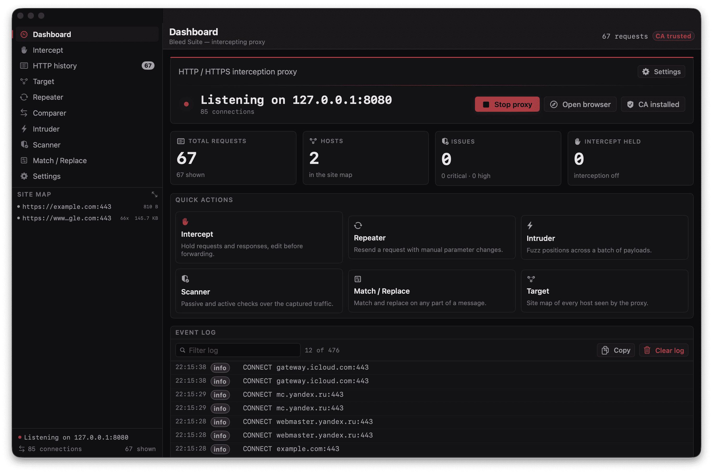

# Bleed Suite | bleedsuite.ru

A native intercepting proxy for macOS — the practical subset of Burp Suite, written
in Swift with no runtime dependencies.



An explicit HTTP/HTTPS proxy that sits between your browser and the network. It
terminates TLS locally with its own certificate authority, records every exchange,
lets you hold and rewrite traffic in flight, and resend requests with parameters
changed.

```
open dist/BleedSuite.dmg     # drag to Applications, launch
```

---

## What it does

| Workspace | Purpose |
|---|---|
| **Dashboard** | Proxy status, CA trust, traffic counters, event log |
| **Intercept** | Hold requests and responses, edit them, forward or drop |
| **HTTP history** | Every transaction, filterable, with a full inspector |
| **Target** | Auto-built site map of every host and endpoint seen |
| **Repeater** | Manual request editor, tabs, response history |
| **Comparer** | Field-level diff between any two exchanges |
| **Intruder** | Payload positions `§`, dictionaries, threads, match rules |
| **Sequencer** | Generate payload sequences for the Intruder |
| **Scanner** | 12 passive checks on captured traffic, 4 active probes |
| **Match / Replace** | Rewrite any part of any message, with a test area |
| **Settings** | Port, CA management, system proxy, scope, export |

Export: HAR 1.2, Burp-style CSV, sitemap XML, scanner issue XML, project files.
Import: HAR and CSV back into the history.

---

## Build from source

Requires macOS 26+ and the Swift 6 toolchain (Xcode 16 or Command Line Tools).

```bash
git clone <repo> && cd BleedSuite

./build.sh          # debug build with errors only
./package.sh        # release build → dist/Bleed Suite.app + .dmg
./package.sh --test # run the engine self test
```

`package.sh` produces a universal binary (arm64 + x86_64), ad-hoc signs it with
non-sandbox entitlements, and builds a styled DMG.

Prebuilt DMGs are attached to tagged releases and archived by CI, so end users do
not need a toolchain at all.

> **Note on the SDK.** Command Line Tools installs ship no `SwiftUIMacros` plugin,
> which every `@State` in SwiftUI needs. Both scripts therefore prefer the
> `MacOSX26.x` SDK when one is present. With full Xcode installed this is automatic.

---

## How the engine works

**TLS interception.** Network.framework cannot upgrade an already-accepted socket to
TLS, so the client's encrypted stream is spliced into one end of a `socketpair`
while Secure Transport runs the TLS server handshake on the other
(`Sources/Core/TLSTermination.swift`). The decrypted stream re-enters the exact
same HTTP pipeline as plaintext traffic.

The socketpair is deliberately split down the middle, because its two halves want
opposite things. The record layer (`tlsFD`) stays **blocking**: Secure Transport's
`SSLReadFunc` / `SSLWriteFunc` are written around blocking descriptors, and driving
them from readiness callbacks desynchronises the record stream — every handshake
dies with `errSSLProtocol`. The relay (`relayFD`) is **non-blocking and
event-driven**: moving ciphertext between the browser and the socketpair needs no
Secure Transport involvement, so it runs off `DispatchSource`s on six shared
queues. That half used to cost one parked thread per session — a single page load
produced 500+ threads, dispatch hit its 512-thread hard limit and the process
stalled. A 600-request soak now holds steady at ~50 threads.

**Certificate authority.** The Root CA and every leaf are produced by the Security
framework alone — no `openssl` binary, no temporary key material on disk
(`Sources/Core/CertAuthority.swift`). Leaf keys live in a dedicated keychain file
inside Application Support rather than the login keychain, and the cache is
bounded with eviction, so a long session does not accumulate hundreds of permanent
key items. Issuing is serialised behind a single lock: those keychain calls are
process-wide and non-reentrant, and minting a dozen leaves concurrently used to
fail outright, silently degrading every MITM session to an opaque tunnel.

**Connection handling.** Client connections are served with keep-alive and HTTP
pipelining; upstream connections come from a bounded idle pool, so browsing does not
pay a TCP + TLS handshake per request. Every connect has a deadline, so a
black-holed origin yields a 502 instead of a hang.

**Body integrity.** Bodies are always `Data`. Binary payloads survive a round trip
through the editors untouched, and chunked responses are decoded and re-encoded
correctly rather than truncated on the wire.

---

## Layout

```
Sources/
  Core/          engine — no UI imports
    HTTPParsing     HTTP/1.1 parser, chunked codec, framing, hop-by-hop rules
    ProxyServer     listener, per-connection sessions, MITM, upstream pool
    ByteStream      NWConnection as an async stream
    TLSTermination  Secure Transport server over a socketpair
    CertAuthority   Root CA, leaf issuance, trust management
    RulesEngine     Match and Replace, plus the scope filter
    InterceptQueue  hold / edit / release
    HistoryStore    thread-safe history with an indexed filter
    BodyStore       SQLite spill for large bodies, project files
    Scanner         passive and active checks
    Intruder        payload positions, dictionaries, sweeps
    Spider          link discovery and crawling
    Exporter        HAR, CSV, XML, project JSON
    System          networksetup / security wrappers
    Repeater        manual request engine, comparer
    Models          HTTP message model, site map, issues, rules
    SelfTest        137 engine checks, run with --selftest
  UI/            native front end (SwiftUI + AppKit)
    Theme           design tokens and the shared colour ramp
    AppModel        application state and the event sink
    RootView        sidebar, workspaces, site map
    UITest          22 checks over the interactive paths, run with --uitest
    …               one file per workspace, AppKit where the row counts are large
scripts/        soak, screenshot and real-world comparison harnesses
```

---

## Testing

Two suites, both run in CI and both runnable locally:

```bash
./.build/debug/BleedSuite --selftest   # 137 engine checks
./.build/debug/BleedSuite --uitest     # 22 UI checks
./package.sh --test                    # release build, then --selftest
```

**Engine (137).** Wire-format edge cases (chunked with trailers, pipelining, binary
bodies, 204/304, 101 upgrades, obs-fold), storage and filtering, rule evaluation, CA
issuance and chain verification, editor round trips, and a live proxy suite that boots
a real listener and drives real exchanges through it — keep-alive reuse, rule rewriting
observed at the origin, and **interception end to end**: a live request is held, never
reaches the origin, carries an edit made in the intercept queue, and the response is
held and released in turn.

**UI (22).** The interactive paths that a headless run cannot reach: Match/Replace
editing, the raw-editor round trip (including that a hand-typed buffer parses back to
itself), repeater tab lifecycle and host derivation, the interception toggle reaching
the engine queue, and history selection.

Synthetic mouse events cannot be delivered from a shell without Accessibility
permission, so the UI suite drives the same state objects the buttons mutate rather
than pretending to click.

**Load and real-world checks** (`scripts/`), used to catch the regressions above:

| script | what it proves |
|---|---|
| `soak.sh` | parallel rounds through a live proxy; thread count and survival |
| `browsersim.sh` | the same, against a real host — hundreds of real TLS sessions |
| `realworld.sh` | five real pages fetched direct **and** proxied, byte-compared |
| `screens.sh` | launches every workspace and captures the window |

---

## Diagnostics

Command-line entry points, all headless:

```bash
./.build/debug/BleedSuite --selftest          # 137 engine checks
./.build/debug/BleedSuite --uitest            # 22 UI checks
./.build/debug/BleedSuite --record 20         # proxy for 20s, print what it captured
./.build/debug/BleedSuite --open repeater     # launch straight onto one workspace
./.build/debug/BleedSuite --dump-cert example.com
./.build/debug/BleedSuite --proxy-on | --proxy-off
```

---

## Typography

Every font goes through `Theme.typeScale` in `Sources/UI/Theme.swift`, which is added
to each size in `Theme.ui`, `Theme.monoSwiftUI` and the `NSFont` mirror used by the
AppKit tables. It is set to `2` — the interface reads small at the nominal sizes. Set
it to `0` for the original sizes; no call site carries a magic offset, so nothing else
needs touching.

---

## Known limitations

- **HTTP/2 is not spoken.** ALPN advertises `http/1.1` only, so h2-only origins are
  downgraded. Sites still work; large responses are slower.
- **No HTTP/3.** QUIC bypasses the proxy entirely.
- **WebSocket frames are tunnelled, not decoded** — the upgrade succeeds and traffic
  flows, but frames are not shown or editable.
- **Passive-only DOM analysis.** XSS probing covers reflected, not stored or DOM
  sinks.
- **No extension API.** Burp extensions in Java/JRuby are not supported.

---

## Legal

For testing systems you own or have permission to test. Intercepting traffic
without authorisation may be illegal in your jurisdiction.
